# Native port progress gallery

Screenshots captured from native Windows x86-64 execution with D3D12 or Vulkan,
using USA BLUS30784 v01.00. These are game-frame GPU readbacks, losslessly encoded
as PNG. All optional metadata has been removed. Images contain the game frame only.

These captures come from a host-compiled recompilation build with a PS3 runtime
layer and observed SPU interpreter fallback. They do not establish
interpreter-free execution; see [architecture](ARCHITECTURE.md).

Current source: 104 SDK patches / 92 Windows checks. The shader-translation
cache reduces measured compilation stalls; existing images retain their original
build provenance. The newest captures show the native FPS overlay in town after
Continue in the 104-patch build, with 30 and Unlocked frame limits. They are final
Vulkan swapchain readbacks after the overlay. The earlier depth-range captures use
99 patches and the menu captures use 83 patches, with their original settings.
The earlier LOD comparison is captured before window scaling. Saving and Continue
reload work; normal shadow polarity is restored. Foot/Logic Stone flicker,
incomplete rendering state and town lag remain open. Still images do not prove
smooth animation, performance, full gameplay or interpreter-free execution.
Historical entries retain their original test conditions and patch counts.

The dated entries after the two overview tables appear newest first; new captures go above the latest entry.
Each dated entry records what was verified at that checkpoint; later entries
supersede earlier limitations when further testing establishes progress.

## Milestones at a glance

From the first native screen to a saved town in five days. Select a row for
the full entry and its limits.

| Date | Milestone | Capture |
| --- | --- | --- |
| 2026-10-19 | [Town FPS checkpoint](#2026-10-19---town-fps-checkpoint) | <a href="#2026-10-19---town-fps-checkpoint">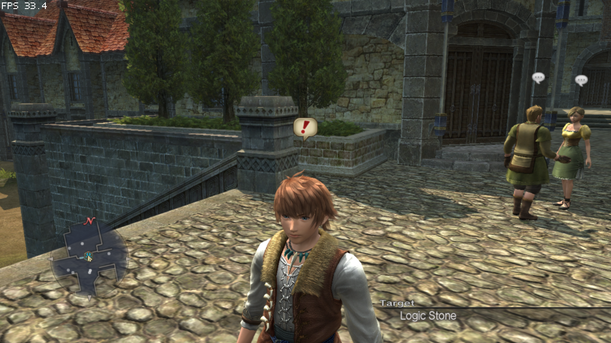</a> |
| 2026-10-15 | [First native screen](#2026-10-15--language-selection) |  |
| 2026-10-16 | [Startup logos play](#2026-10-16--d3publisher-logo-playback) |  |
| 2026-10-16 | [Title menu](#2026-10-16--title-menu) | <a href="#2026-10-16--title-menu">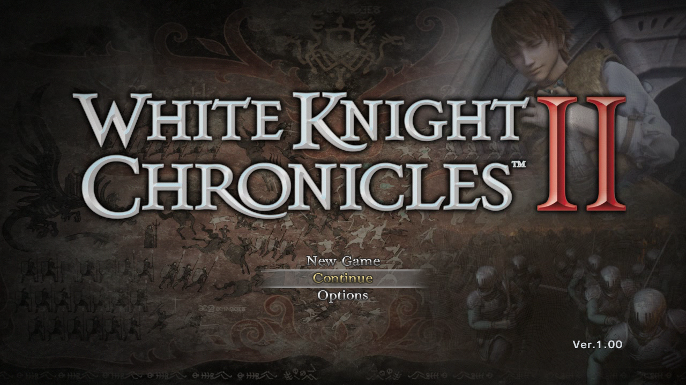</a> |
| 2026-10-16 | [First 3D room](#2026-10-16--3d-room-with-normal-depth) | <a href="#2026-10-16--3d-room-with-normal-depth">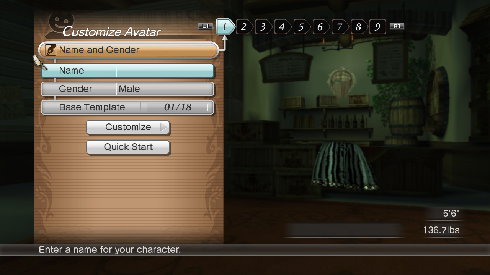</a> |
| 2026-10-16 | [Avatar creation](#2026-10-16--vulkan-avatar-colours-restored) | <a href="#2026-10-16--vulkan-avatar-colours-restored">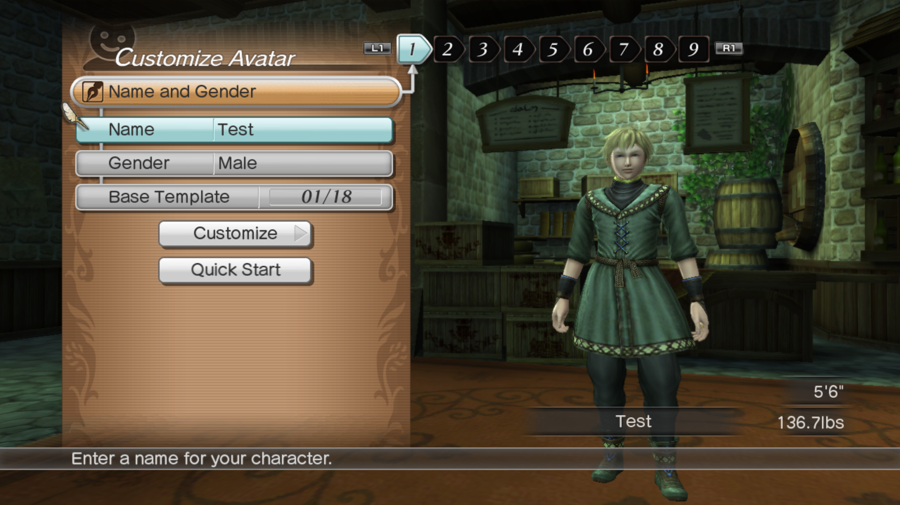</a> |
| 2026-10-16 | [Town reached](#2026-10-16--wkc1-town-world-view) | <a href="#2026-10-16--wkc1-town-world-view">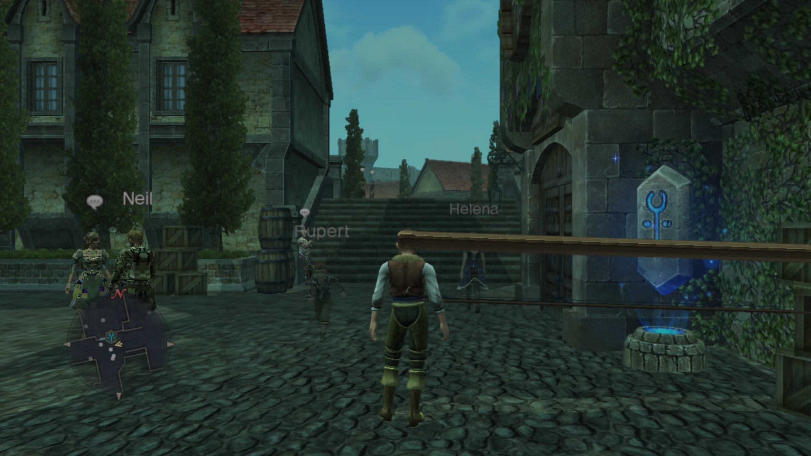</a> |
| 2026-10-17 | [Walking and camera](#2026-10-17--town-movement-and-camera-response) | <a href="#2026-10-17--town-movement-and-camera-response">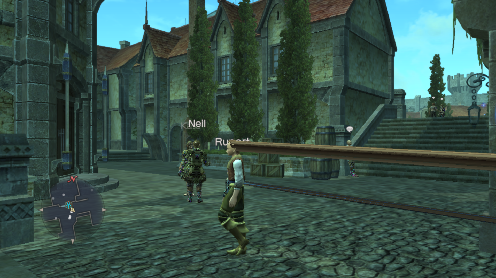</a> |
| 2026-10-17 | [Stretching fixed](#2026-10-17--town-stretching-fixed-secondary-bone-physics) | <a href="#2026-10-17--town-stretching-fixed-secondary-bone-physics">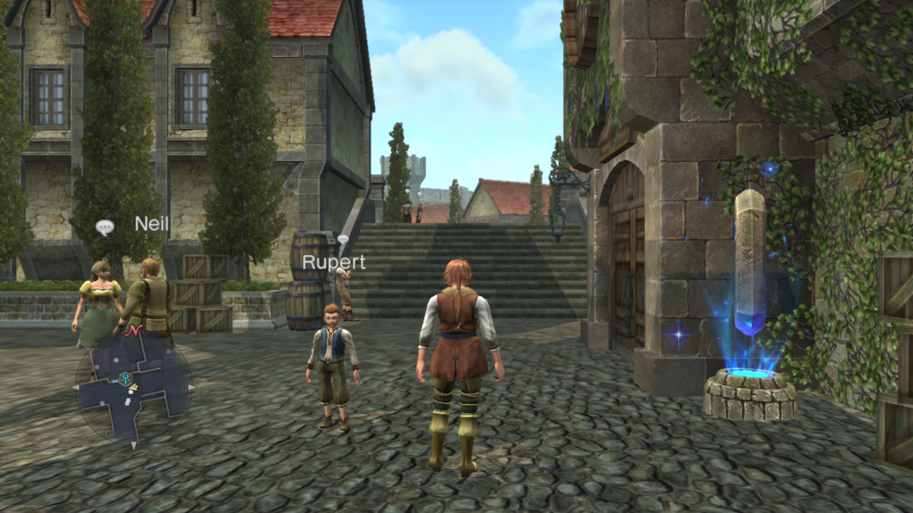</a> |
| 2026-10-18 | [Save and Continue](#2026-10-18---logic-stone-saving-and-restartcontinue-reload) | <a href="#2026-10-18---logic-stone-saving-and-restartcontinue-reload">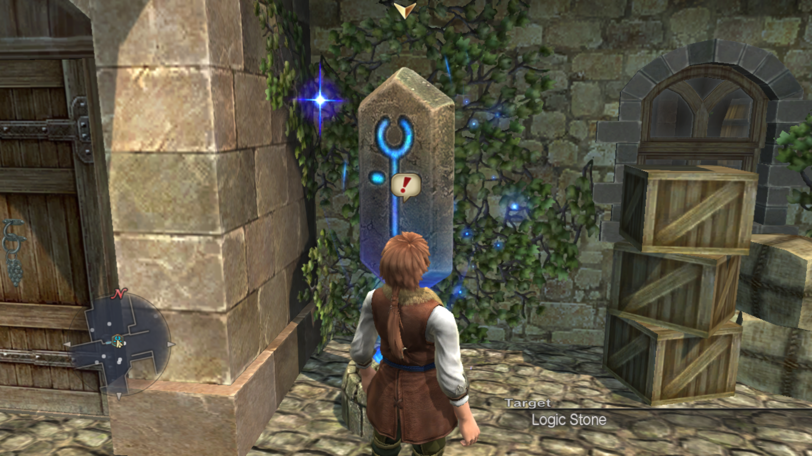</a> |
| 2026-10-18 | [Graphics Settings](#2026-10-18---native-graphics-settings) | <a href="#2026-10-18---native-graphics-settings">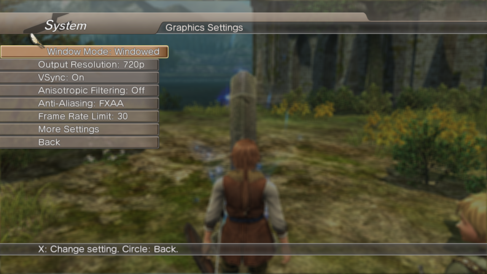</a> |
| 2026-10-19 | [Depth range check](#2026-10-19---window-depth-clip-range-check) | <a href="#2026-10-19---window-depth-clip-range-check">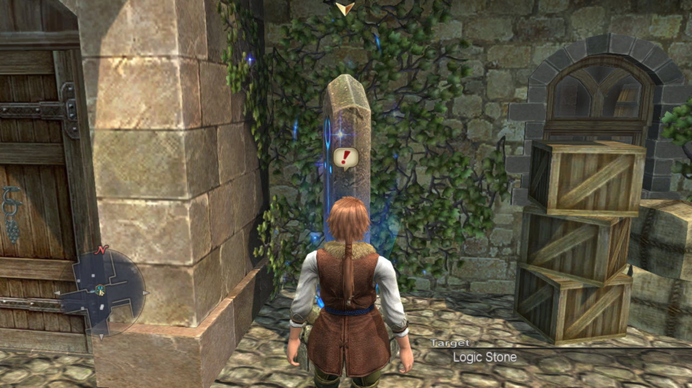</a> |

## Before and after

Fixes with a visible difference. Each entry below gives the test conditions.

| Change | Before | After |
| --- | --- | --- |
| [Texture detail (patch 0079)](#2026-10-18---requested-texture-detail-restored) Same executable, save and camera. | 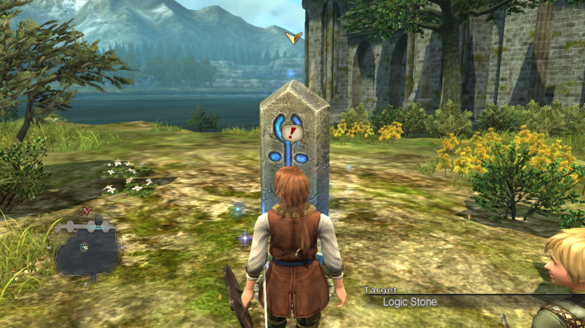 Bias forced to zero | 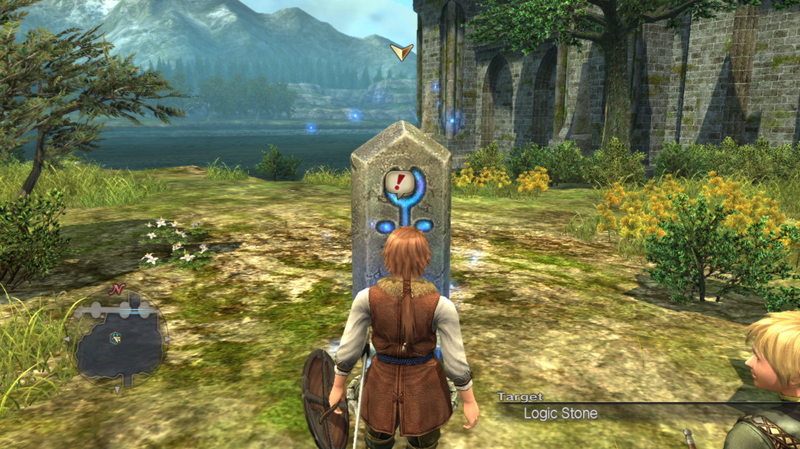 Requested LOD bias applied |
| [Town stretching](#2026-10-17--town-stretching-fixed-secondary-bone-physics) Different builds and runs. | 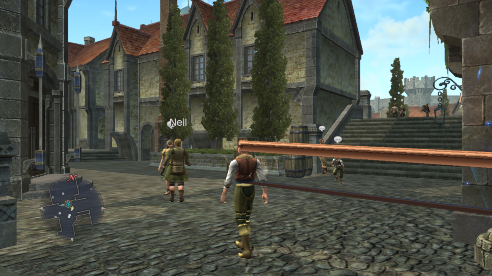 Strips at Leonard (52 patches) |  Secondary-bone physics job restored (58 patches) |
| [Foot shadow](#2026-10-18---earlier-shadow-regression-polarity-fixed-in-patch-0074) Different builds and camera positions. | 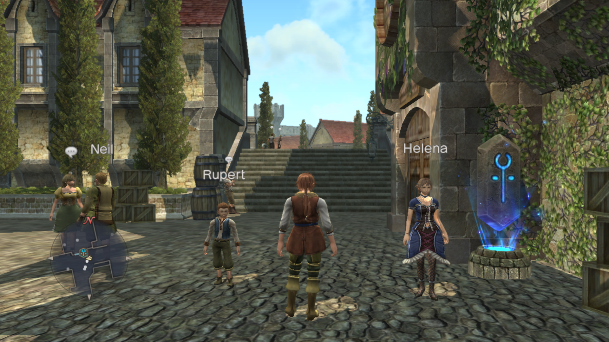 Bright patch under Leonard (73 patches) |  Polarity fixed in patch 0074 (99 patches) |

## 2026-10-19 - Town FPS checkpoint

The 104-patch Vulkan build reloads the verified WKC1 save through Continue.
These fresh captures show the native FPS counter in town with the frame limit
set to Unlocked and 30. All 92 Windows checks pass in Debug and Release.

**Unlocked: the counter shows 33.4 completed presentations/s at capture.**

**30 limit: the counter shows 29.5 completed presentations/s at capture.**

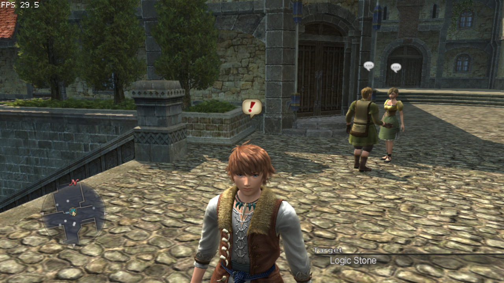

Both images are unmodified 1280x720 final swapchain GPU readbacks, copied after
the unchanged native FPS overlay and GPU completion. FXAA is off. The hidden
runs had audio muting verified and used a short camera turn after loading.
Their camera angles differ, so these are not a controlled performance comparison.
The counter records presentations at capture; still images do not establish a
sustained frame rate, smooth animation or unique game updates. Foot/Logic Stone
flicker and wider rendering fidelity remain open.

## 2026-10-19 - Window-depth clip range check

Patch 0098 pairs requested depth intervals with vertex normalization. The final
99-patch candidate also initializes timezone and retail GPIO query outputs. All
84 Windows checks pass in Debug and Release. It loads Continue and moves briefly
in town in a hidden/muted run.

These unmodified final readbacks show the save-point and ground views after
the 99-patch reload. An earlier 98-patch candidate supplied the off/on comparison. No clear foot/Logic Stone flicker reduction is
established. Still images do not prove smoothness, performance or full fidelity.

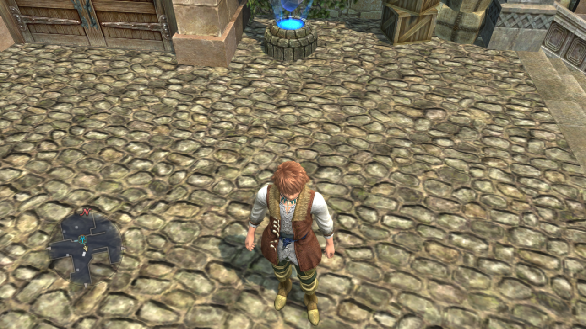

## 2026-10-18 - Fragment input and request coverage check

The 96-patch candidate reloads Continue and moves through town after coordinate
override, perspective correction and conditional shader-write fixes. All 82
Windows checks pass in Debug and Release, including synthetic GPU shader checks.
Diagnostic probes now list known active rendering gaps automatically.

This unmodified final swapchain frame comes from the hidden/muted candidate after
short movement. It checks scene continuity, not a visible improvement, smoothness
or FPS gain. Foot/Logic Stone flicker and incomplete rendering fidelity remain open.

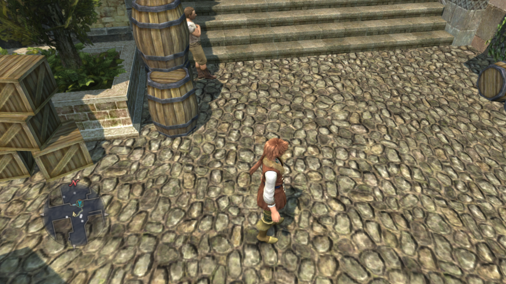

## 2026-10-18 - Vulkan polygon offset check

Patch 0094 forwards the game's fill-polygon offset to Vulkan. All 80 Windows
checks pass in Debug and Release, including synthetic GPU depth readbacks.
The hidden/muted native candidate reloads Continue and moves in town.

These unmodified final swapchain readbacks come from the same executable and
camera with requested offset **enabled** (first) and forced **off** (second).
Idle animation, NPC poses and the rotating stone effect differ between frames.
The short sequences show no clear flicker reduction; foot/Logic Stone flicker
remain open. These are correctness-check captures, not an FPS comparison.

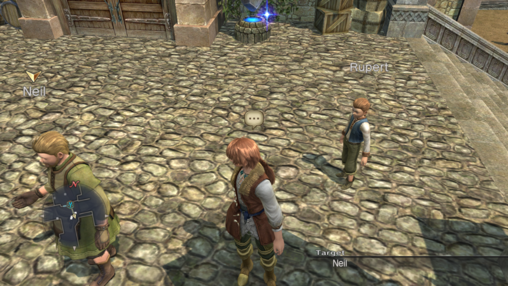

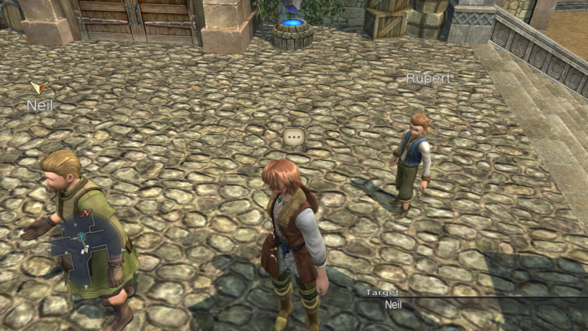

## 2026-10-18 - Task scheduling and SPU byte-operation checks

The 93-patch Vulkan build reloads the save and reaches this town view after
short movement. Task completion now follows reservation locking, and task ELF
flag bits are masked. Byte shifts/rotates have a tested SIMD implementation
with a scalar fallback. All 79 checks pass in Debug and Release.

This final swapchain readback comes from the hidden, muted diagnostic build
with SIMD selected. The mixed native timing comparison does not establish a
sustained FPS gain; the still image proves neither speed nor a rendering fix.

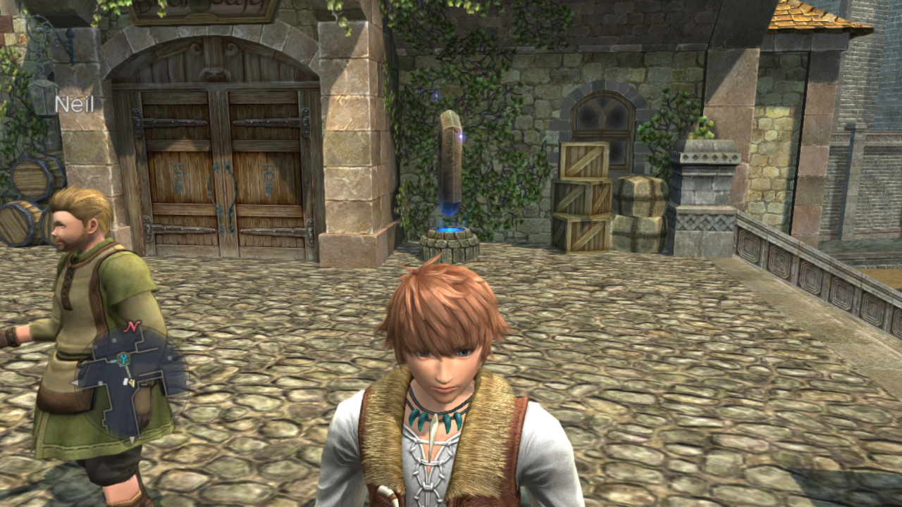

## 2026-10-18 - Runtime correctness and controller input follow-up

The 90-patch Vulkan build reloads the verified town save. This game-only frame
comes from a hidden, muted synthetic input check, after a partial raw stick tilt.
The new regressions cover SPU instructions, PPU saturating subtraction, diagonal
stick range, concurrent report publication and complete pad API registration.
All 77 checks pass in Debug and Release. Physical-controller walk/run feel and
any performance gain remain unverified; this is not evidence of a visual fix.

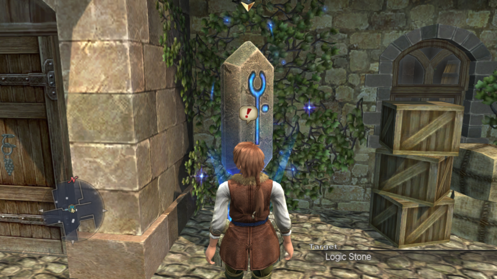

## 2026-10-18 - Full Graphics Settings panel and window close

Graphics Settings now uses the game's full settings box, with its native frame,
scrollbar, selection arrows and highlight. All eleven options and Back fit in
one panel. Up/Down selects, Left/Right or X changes a value, and Circle or Back
returns to System. The normal Game Settings page retains its original controls.

These final Vulkan swapchain readbacks show the panel and the FPS toggle after
moving through its rows. The window close event now exits normally; title and
saved-town settings integration tests end with code 0 without forced termination.
All 72 Windows checks pass in Debug and Release with 83 SDK patches.
Distance/fog controls and menu background blur removal remain pending.
Diagnostic screenshots and their counters are not performance benchmarks.

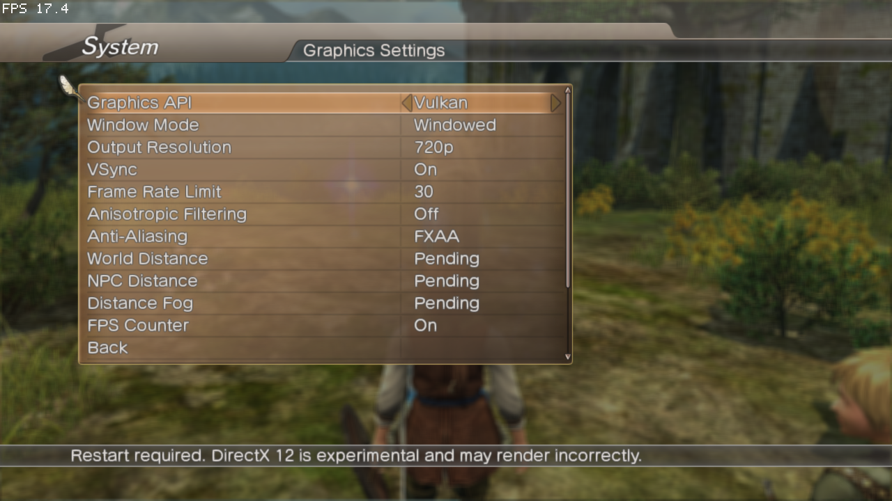

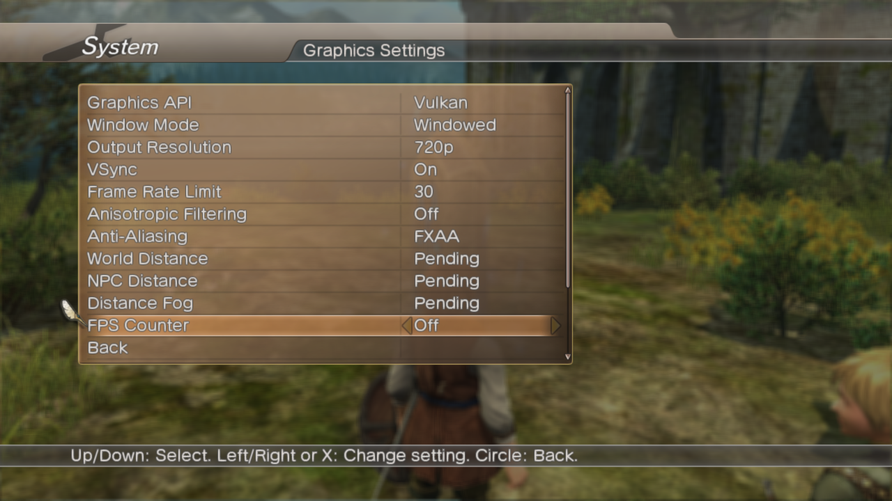

## 2026-10-18 - One scrolling Graphics Settings list

Historical layout, superseded by the full panel above.

All graphics controls now share one scrolling list. The original eight visible
rows show a moving window over twelve items, including Back. Up/Down scrolls
at the edges and wraps between first and last; Circle returns directly to System.
The heading shows the visible range. There is no More Settings page.

These final Vulkan swapchain readbacks show the top and bottom of the list.
Native checks cover scrolling, selection alignment and changing the FPS overlay
after scrolling. All 72 tests pass in Debug and Release. The 82 SDK patches,
rendering options and timing implementation are unchanged. The display is still
blurred behind the menu; world/NPC distance and fog remain inactive and labelled
Pending. Neither these screenshots nor their counters prove game performance.

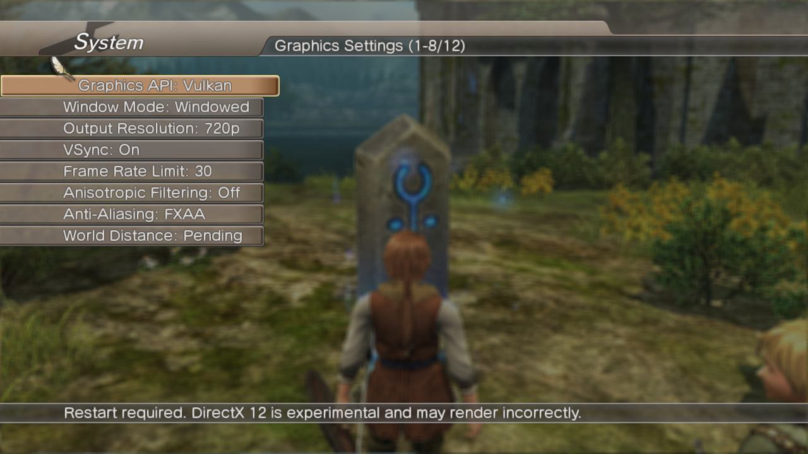

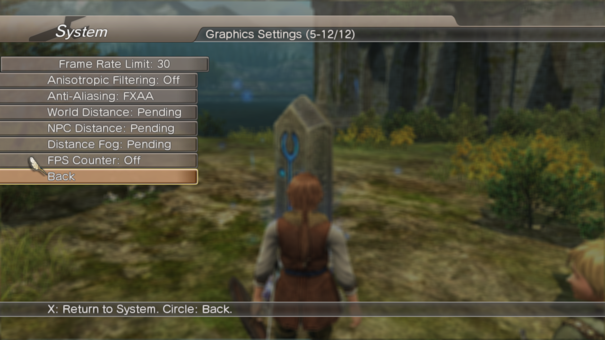

## 2026-10-18 - Native Graphics Settings

The native System menu now has a Graphics Settings entry. These 82-patch captures
show actual game widgets after Continue loaded the save, with FXAA enabled.
All 72 Windows checks pass in Debug and Release. The frame-rate control now
changes guest pacing as well as the host limit; short saved-scene samples exceed
30 completed frames/s with normal sampled game-clock speed. These images do not
prove a frame-rate gain. See [measurements and limits](FINDINGS.md#native-graphics-settings-and-frame-rate-control).

Primary page: windowed/borderless/fullscreen, named output resolution, VSync,
anisotropic filtering, Off/FXAA and 30/40/60/120/144/Unlocked limits:

More Settings contains the renderer choice, draw-distance submenu and FPS toggle.
The asterisk means DirectX 12 has been selected for the next restart; this capture
is still Vulkan. DirectX 12 also reaches the save and menu in a separate test, but
has visible differences and does not implement the Vulkan display preferences,
FXAA or overlay. Vulkan remains the default:

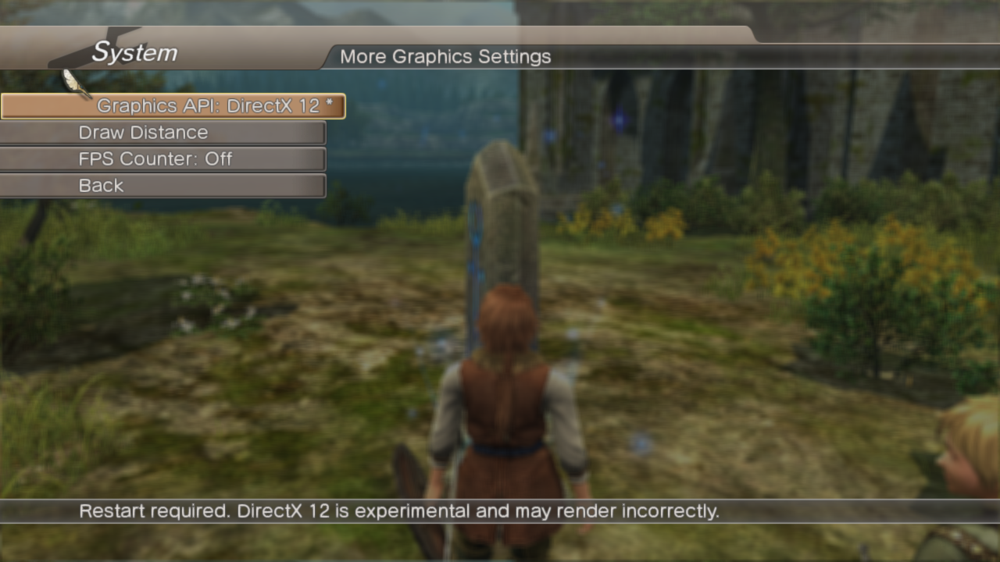

The separate entry lives under System:

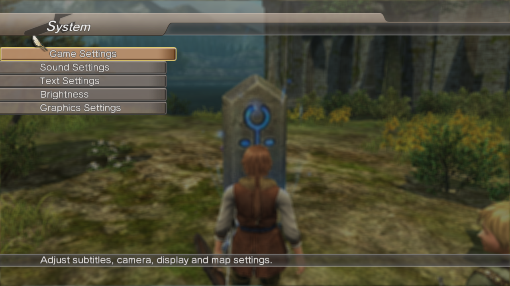

World/NPC distance and fog are placeholders, visibly pending and inactive.
The game's background blur remains in all these pages:

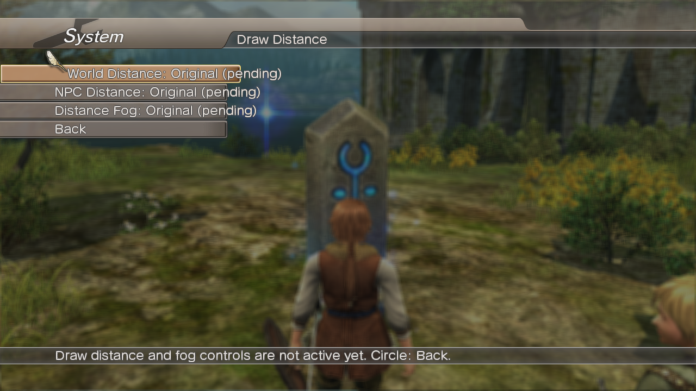

## 2026-10-18 - Requested texture detail restored

Patch 0079 honors the game's negative texture LOD bias instead of sampling
blurrier mip levels. All 67 Windows checks pass in Debug and Release.
One hidden, muted executable switched bias off/on at the same loaded save and
camera. These GPU readbacks precede window scaling; idle animation and the
rotating stone differ. No render-resolution increase or FPS gain is claimed.
Private A/B controls are absent from the published patch. See the
[rendering-state audit](FINDINGS.md#texture-detail-and-rendering-state-audit-patch-0079)
for the remaining omissions.

Requested bias applied:

Bias forced to zero, reproducing the previous behavior in the same executable:

## 2026-10-18 - Vulkan batch scheduling in the saved town

Patch 0076 avoids pool-only submissions and submits small batches when the spare
slot is ready. One-minute stationary samples average 27.18 presentations/s before
and 28.03 after with file logging and sampling off. A locked 30 fps and full game-speed
fidelity remain unverified; see [conditions and limits](FINDINGS.md#vulkan-batch-scheduling-patch-0076).
The 76-patch build passes all 64 Windows checks in Debug and Release.

The native frame below was captured after Continue loaded the verified town save.
It documents the scene, not the measured frame rate or flicker cadence.

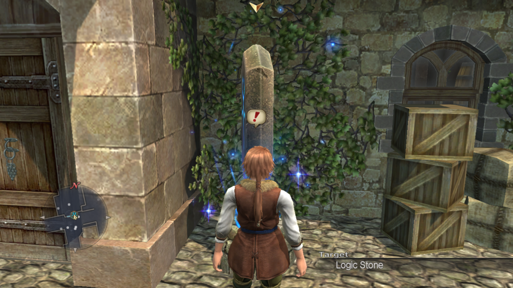

## 2026-10-18 - Logic Stone saving and restart/Continue reload

Patch 0075 delivers previously dropped FIFO user-command interrupts to the
registered native callback. The Logic Stone now highlights on approach and
opens with X. Save writes a new local slot; after fully restarting the program,
Continue loads it and returns to town. Both Windows suites pass all 63 checks.
This covers one starting-town save on the same build; wider save compatibility
is unverified. Lag, analogue walk/run inconsistency and remaining flicker are open.

At this checkpoint, the later of the two captures shows the reloaded town
and selected Logic Stone:

The earlier capture shows its normal menu, opened with X before choosing Save:

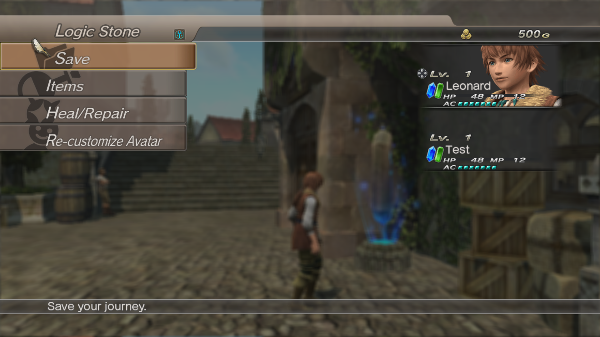

## 2026-10-18 - Earlier shadow regression (polarity fixed in patch 0074)

The 73-patch native Vulkan build reaches the WKC1 town after character
creation and the opening cutscenes. It passes 63 Windows regression checks.
The bright patch beneath Leonard is a known rendering regression in the new
depth-comparison path. Black flickering at his feet is also observed in motion.
This unchanged game-frame readback records the fault; it does not establish
correct shadows, sustained frame rate or complete gameplay.

## 2026-10-17 — Town stretching fixed: secondary-bone physics

The 58-patch native Vulkan build executes the previously missing SPURS queue physics
job, statically translated to C/C++. Leonard's hair and clothing remain on
the model instead of stretching across the street. The long strips are absent
in the inspected starting-town views, including after short movement and
camera rotation. All 51 Windows runtime checks pass.

Private replay of 128 captured geometry jobs finds normal referenced vertex
bounds throughout; 21 of 128 samples before the fix had extreme offsets.
See the [trace and limits](FINDINGS.md#secondary-bone-physics-and-town-stretching).
At that checkpoint, full rendering fidelity, sustained traversal, combat and
save/load were unverified. Later entries above record local saving.

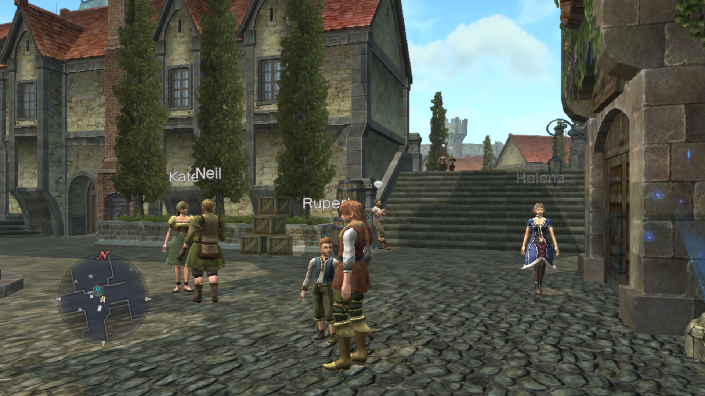

## 2026-10-17 — NPC surfaces after NV0039 transfers

The 52-patch native Vulkan build implements NV0039 byte copies and routes
their methods away from 3D state. Previously speckled NPC surfaces look
coherent in the inspected town views, including after short movement and
camera rotation. The run verifies at least 65,536 copies without mismatch
or rejection diagnostics. Full material fidelity remains unverified.

**The stretched strips at Leonard were still present at this checkpoint.**
The newer physics milestone above removes them in the inspected town views.
This capture records the earlier NPC surface improvement; it does not establish
complete rendering correctness. Sustained traversal, combat and save/load
were unverified at this checkpoint; local saving was verified later.

## 2026-10-17 — Town movement and camera response

The full 42-patch native build reaches the town and responds to left-stick
movement and right-stick camera input. Successive GPU readbacks show walking,
facing changes, a changed minimap position and a rotated view of the street.
The SPU census was active throughout this run. This is limited starting-town
input validation; sustained traversal, combat and save/load were unverified
at this checkpoint. Local saving was verified later.
Stretched geometry and corrupt NPC surfaces were still visible at this checkpoint;
the later fixes are recorded above.

## 2026-10-16 — WKC1 town world view

This earlier native Vulkan run reached the town after avatar acceptance and the
opening cutscenes. Leonard, the surrounding buildings, NPC names, minimap and
save crystal appear in live 3D. Pause/resume input was checked separately in
the same run. Fixing a runtime cutoff that halted valid SPU completion-label
polling lets this run pass the previous loading stall.

Stretched triangles and corrupt NPC surfaces are visible in this unchanged
readback. Movement and camera control were unchecked in this run and were
verified in limited town probes on 2026-10-17. Sustained traversal, combat and
save/load were unverified in this run; later entries record local saving.
The 1920×1080 display readback contains the game's 1280×720 scene.

## 2026-10-16 — Vulkan avatar colours restored

The initial Vulkan colour-feedback fix shows the WKC1 avatar and room without the
red tint seen in its first build. A post-processing draw reads the colour target
it is updating; preserving the preceding pixels in a separate GPU image restores
the missing colour channels. The entered name is retained. This is live 3D
rendering from the hybrid C/C++ build with the shared RSX draw engine.
The 1920×1080 display readback contains the game's 1280×720 scene. Full visual
fidelity was not established by this capture. Later town rendering and limited
controls and local save/reload were verified later, as recorded above. macOS
execution remains unverified.

## 2026-10-16 — WKC1 opening movie after avatar confirmation

At this checkpoint, the native executable accepted the avatar and entered the
WKC1 opening movie. Presenting completed batches at guest FIFO flips prevents
small movie batches from being withheld by the earlier scene threshold. This
capture shows prerecorded footage, using freshly regenerated PPU and SPU code.
Live town rendering and limited controls were verified later, as recorded above.

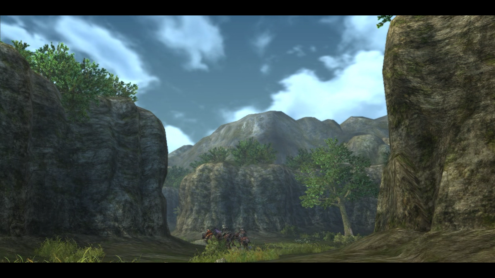

## 2026-10-16 — Character name retained through avatar review

This checkpoint verified name retention through Quick Start to final Review,
with the avatar, face shading and textured clothing visible under normal depth
testing and culling. Avatar acceptance and town entry were verified later.
A gamepad-operated in-game keyboard is planned; the Windows text-entry window
is temporary.

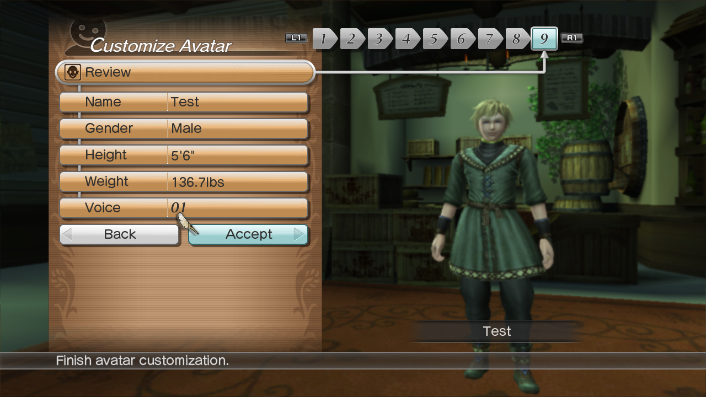

## 2026-10-16 — Avatar face and clothing shading

Correcting packed vertex normals and fragment source-range modifiers revealed
the shaded face and textured clothing of the default male avatar, with normal
depth testing and culling. This version 1.00 capture predates avatar acceptance
and town validation. Full visual fidelity remains unverified.

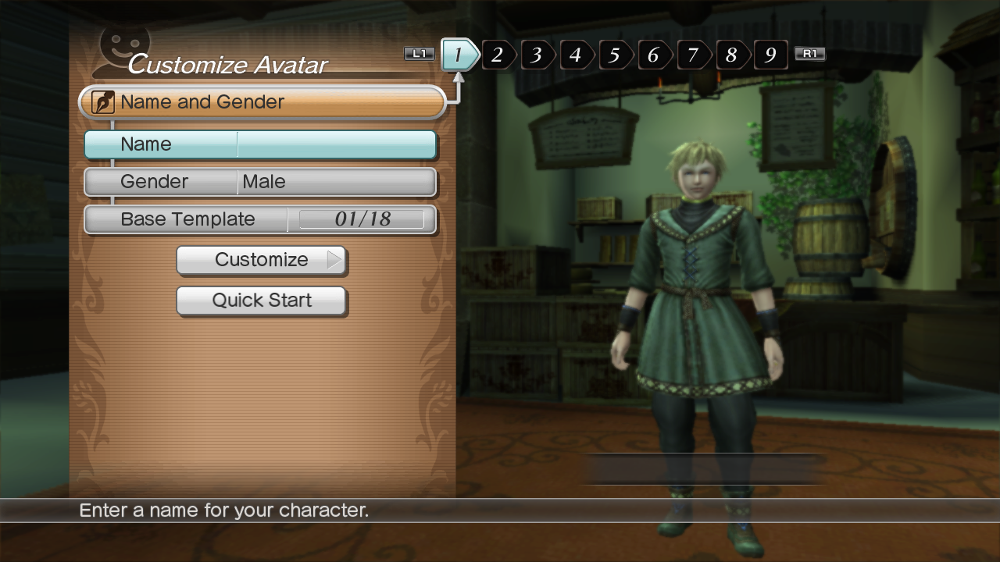

## 2026-10-16 — Avatar body geometry

Correcting SPU FNMS extended-range arithmetic revealed the previously missing
arms, hands, trousers and boots, with normal depth and culling. Face shading and
clothing materials were still incorrect in this version 1.00 capture; later
fixes and town progress are recorded above.

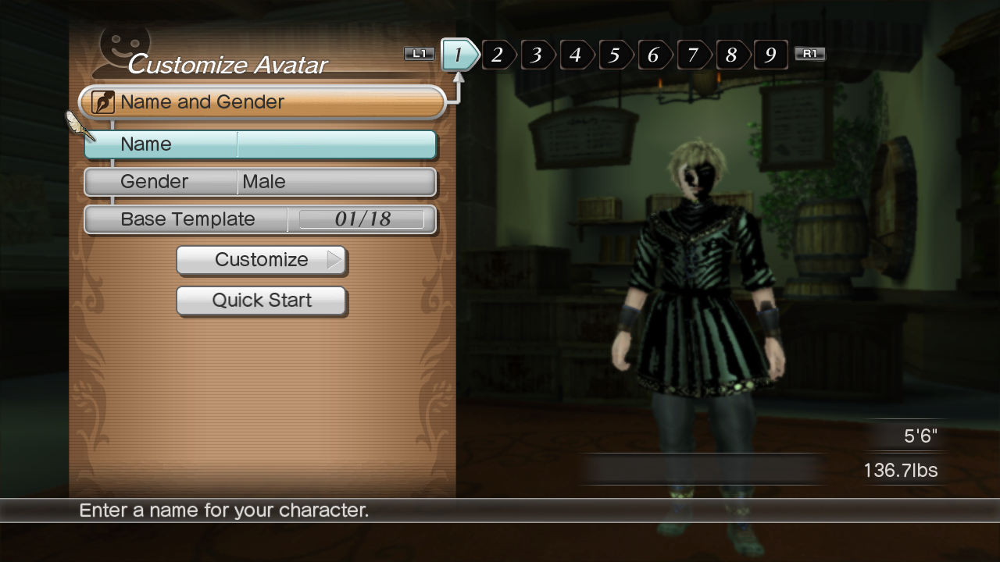

## 2026-10-16 — 3D room with normal depth

Correcting indexed triangle strips and primitive restart made the WKC1
character-creation room render with normal depth testing. Some avatar pieces
appeared, but the body was incomplete in this version 1.00 capture. Later
entries record the complete default avatar, avatar acceptance and town progress.

## 2026-10-16 — Avatar customization UI

This version 1.00 checkpoint reached Customize Avatar and dismissed its
introductory notice through controller input. Text and menu controls rendered,
but the character model was missing at the time. Later entries record the
avatar rendering fixes and progression into the town.

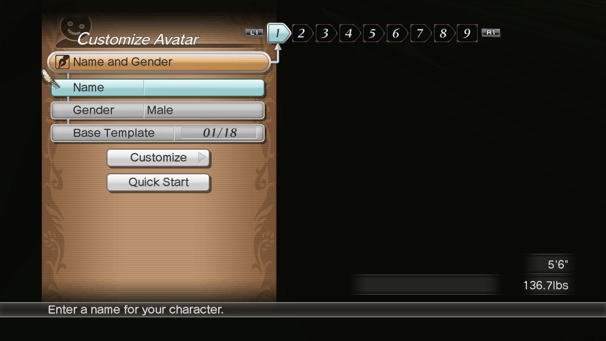

## 2026-10-16 — White Knight Chronicles I selected

This checkpoint selected the first White Knight Chronicles through native
controller input, with readable description and dialog text. Loading then
stopped at a job with an empty SPU binary source. That failure was resolved
before the later avatar and town milestones above.

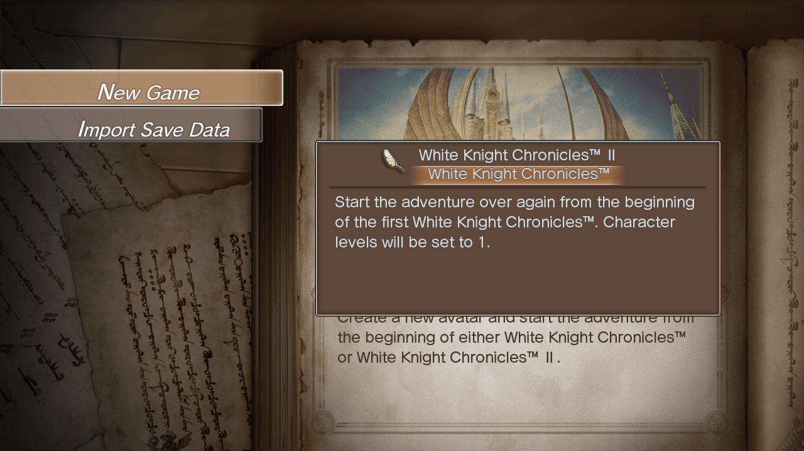

## 2026-10-16 — Readable New Game description

Fixing packed font texture bindings made the native New Game description
readable. This capture verifies that menu text; later progress is recorded above.

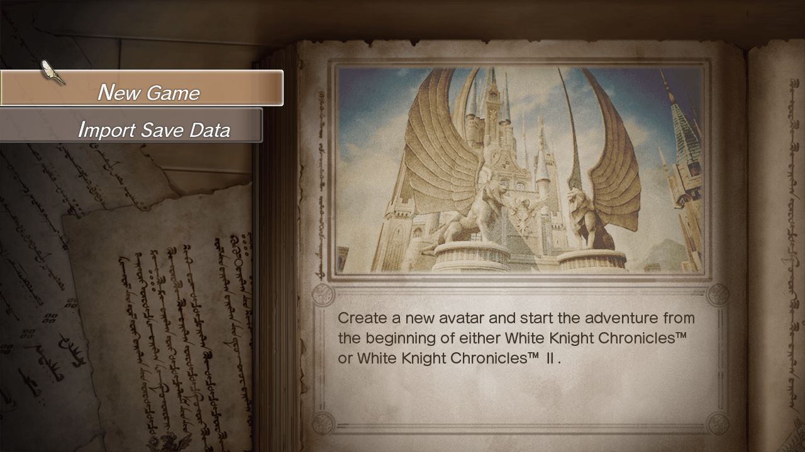

## 2026-10-16 — New Game submenu

At this checkpoint, live controller input moved the title highlight and opened
New Game, showing its book artwork, labels and cursor. Description and dialog
text still appeared as blocks; the later font fix is recorded above.

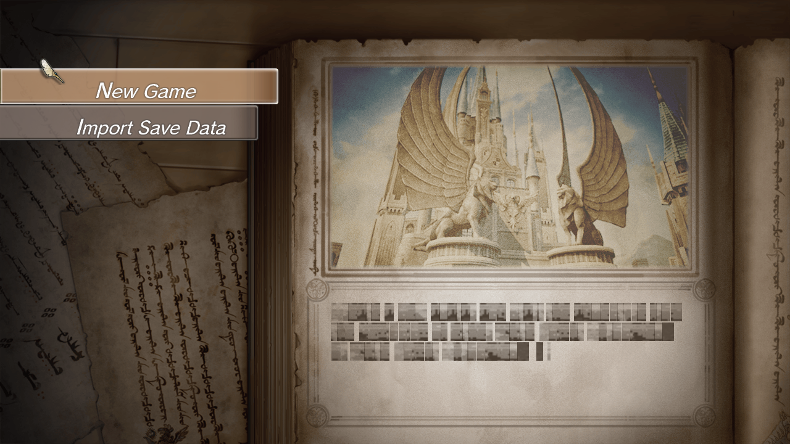

## 2026-10-16 — Title menu

The native title menu displays New Game, Continue and Options over the animated
background. Successive captures show the title artwork changing. With no input,
the guest subsequently opens its attract movie. This capture proves menu rendering;
menu response, avatar acceptance and limited town controls were validated later.

## 2026-10-16 — Startup advances to Havok / Dolby

The same native run reaches the Havok and Dolby Digital screen after the studio
logos. This is a later startup stage, before the AC-3 title background was supported.

## 2026-10-16 — Japan Studio

Japan Studio appears as startup proceeds beyond the earlier movie stall.

## 2026-10-16 — Sony presents

Startup advances to the Sony Computer Entertainment presentation screen.

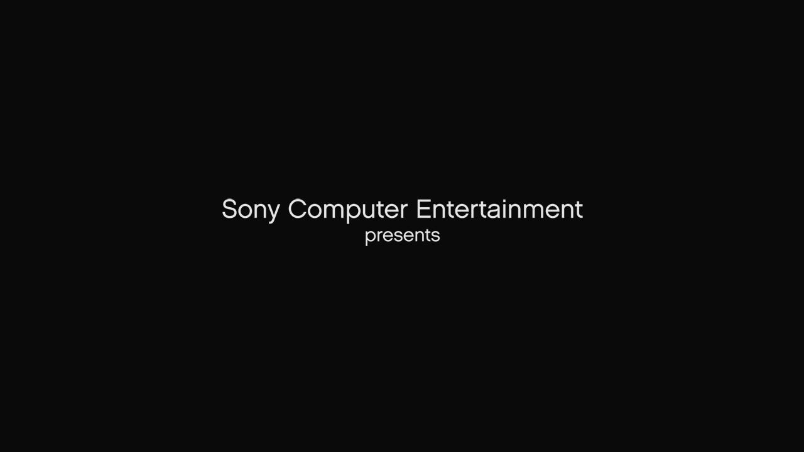

## 2026-10-16 — D3Publisher logo playback

The first logo movie now animates through to the formed D3Publisher logo.
Successive GPU readbacks show different movie frames, and the guest then closes
and reopens the decoders for the next startup movie without a skip input.

## 2026-10-16 — First decoded logo frame

The startup movie now passes through real MPEG-2 decoding, YUV-to-RGBA processing
and the native renderer. This image is a GPU readback of the first logo sequence.
At this milestone, later captures held this image and continuous animation was unverified.
Audio output was still a placeholder at this milestone. This establishes visible decoded video,
not completed playback or title-screen rendering.

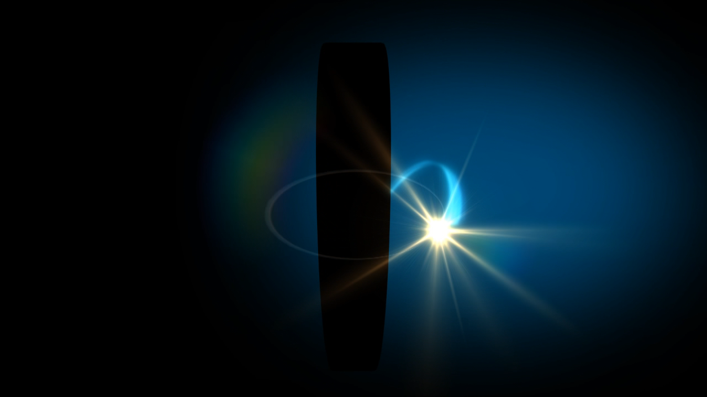

## 2026-10-15 — Autosave notice

The autosave notice renders at a later startup stage. This screenshot establishes
that the notice displays; it does not establish that saving or loading works.

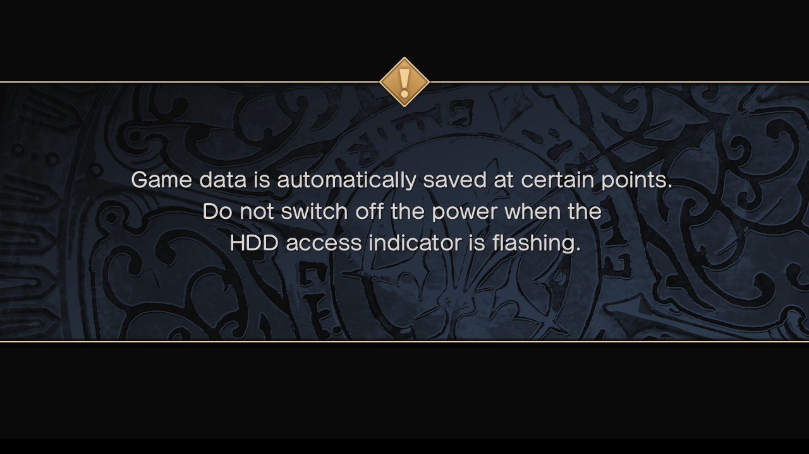

## 2026-10-15 — Startup warning

The warning icon, panel artwork and instruction-manual notice render after language
selection. This establishes another visible startup stage.

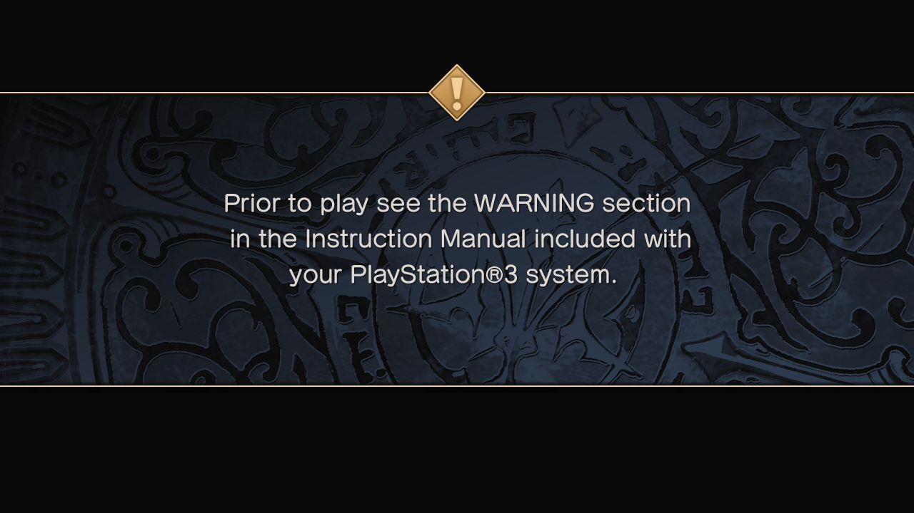

## 2026-10-15 — Language selection

The background, cursor, highlighted English option and other language options render.
A simulated CROSS press through the controller path selects English and advances startup.

## Evidence and updates

D3D12 captures are 1280 × 720; Vulkan display captures are 1920 × 1080 and
contain the game's 1280 × 720 scene. Every published pixel was compared with
the original BMP or PPM GPU readback before publication. The [capture manifest](../verification/gallery.json) records
source and PNG hashes. Full probe logs and original captures remain private.

New verified visual milestones will be added here as development progresses.
Captions state the observed behavior; screenshots alone do not prove unrelated
features or full-game compatibility.

Game artwork and text belong to their respective rights holders; the project's
source-code license does not relicense game content shown in these screenshots.
